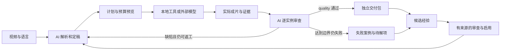

# 架构与职责

这个项目像一间制作工作室：Codex 看图识字、直接处理图片并决定怎么做，执行器操作媒体工具，运行目录保存现场，知识库保存以后还能用的经验。

## 谁负责什么

| 层 | 项目位置 | 责任 |
| --- | --- | --- |
| AI 主控入口 | `AGENTS.md`、`.agents/skills/` | 理解请求、翻译、选路、实际观察、判断返工 |
| 执行合同 | `agent/contracts/` | 质量、声音、字幕、知识和证据的共同约束 |
| 专项方法 | `agent/workflows/`、`knowledge/rules/` | 按内容条件选择步骤和检查方式 |
| 偏好与参数 | `config/profiles/`、`config/` | 有来源的偏好、质量阈值、预算、模型策略 |
| 调用入口 | `bin/`、`agent/integrations/` | CLI/MCP 适配及外部工具使用约定 |
| 实现 | `src/video_localizer/` | 媒体计算、任务账本、缓存、审核门禁、归档 |
| 独立知识 | `knowledge/` | 方法、同源参考、反例、证据和未启用候选 |
| 本机资产与状态 | `.runtime/`、`runs/`、`media/`、`outputs/`、`state/`、`work/` | 安装资产、现场、复用素材、账务及临时工作 |

目录按责任和生命周期划分，通常由同一个执行器读取，并不是每个目录各有一个 Agent。

## 一次任务的循环

`workflow.py` 承担计划、制作与质量的主要合同；`production.py`、`batches.py`、`work_packet.py` 负责阶段导航、恢复和语言编排。媒体、排版、修复、声音和视觉采证是可复用模块。执行成功只说明产生了结果；语义、残字、运动、音色和同步由真实观察决定。

## 对外连接

宿主通过 CLI 或 stdio MCP 调用项目；项目通过受控适配器调用 KIE，凭据只由执行器读取。预算、任务号、未知状态和结果哈希落在项目账本中。Codex 的图像工作包绑定实际图片、规则、知识和产物；ASR 与分轨读取 `.runtime/` 安装资产，TTS、音频理解及视频编辑使用受控 KIE 入口。见 [模型分工](../agent/contracts/model-routing.md)。

每日知识提纯由项目 Hook 持有调度配置、提示词、输入和检查点，Codex CLI 是可替换的推理接口。Hook 形成候选；启用方法和改变偏好遵守项目知识合同。

## 复用与失效

源解析按完整源哈希和参数复用；制作缓存还核对定稿、参数、实现与工具版本。底片、声音、字幕和审核具有各自的适用范围。新语言重建稿件、声音、时间轴和检查；质量异议按实际哈希阻止旧版本继续生产。

独立证据包保留自身文件和 manifest，不要求旧 run 永久存在。现行方法与源限定参考分开检索，旧版本集中保留。详细生命周期见 [存储合同](../agent/contracts/storage.md)。
