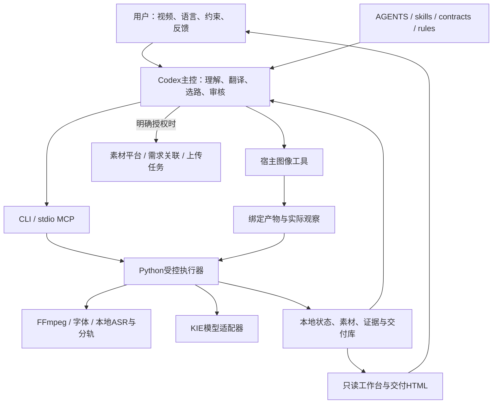
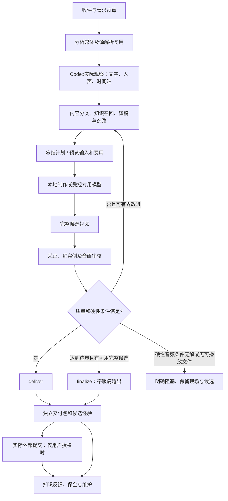
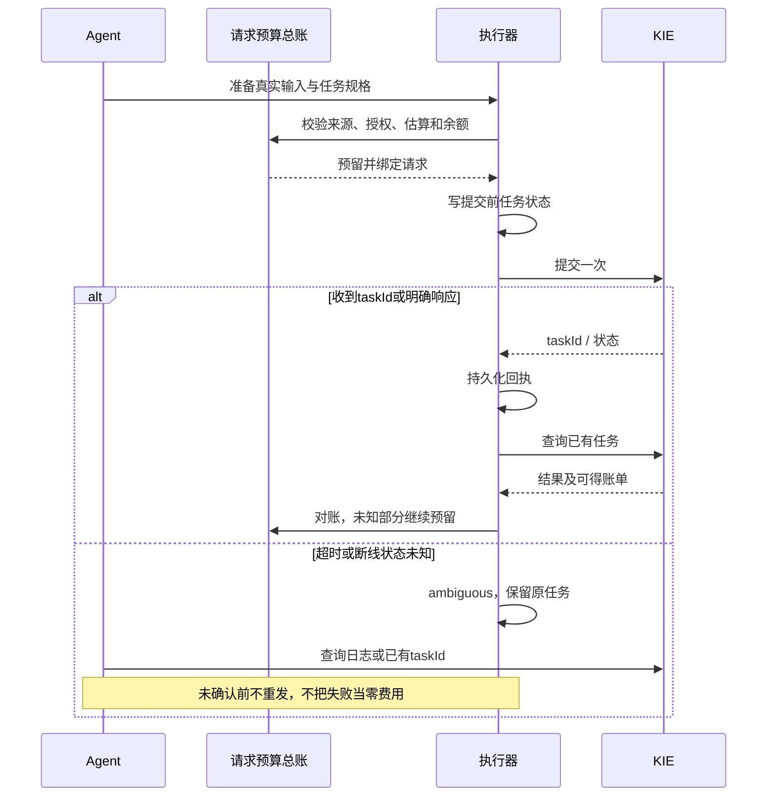
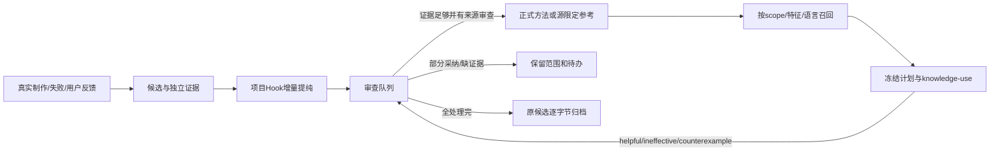

# 广告视频本地化 Agent——概要设计

**目录**

- [1. 系统定位与架构约束](#section-1)
- [2. 系统上下文](#section-2)
- [3. 分层设计](#section-3)
- [4. 核心领域对象](#section-4)
- [5. 端到端控制流程](#section-5)
- [6. 视觉制作设计](#section-6)
- [7. 音频与字幕设计](#section-7)
- [8. 请求预算和远端任务设计](#section-8)
- [9. 状态与恢复设计](#section-9)
- [10. 计划、缓存和失效](#section-10)
- [11. 持久化及目录设计](#section-11)
- [12. 知识闭环设计](#section-12)
- [13. 并发、安全与一致性](#section-13)
- [14. 部署和运维设计](#section-14)
- [15. 实施与演进决策](#section-15)
- [16. 与需求、详细设计的映射](#section-16)


基线：2026-10-26 当前工作区。前置阅读：[需求文档](需求文档.md)。实现细节、字段与完整接口目录见[详细设计](详细设计.md)。设计目标是把可由程序确定的完整性约束交给执行器，把依赖语义、视觉和听觉的判断交给有来源的实际审查。

<a id="section-1"></a>

## 1. 系统定位与架构约束

系统是本机文件驱动的 Agent 工作环境。Codex 是控制与判断主体，Python 包提供受控操作，CLI和stdio MCP是调用适配层；工作台是独立只读投影。当前没有业务数据库服务、分布式任务队列或多租户后端。JSON文件、媒体字节、manifest、锁文件和哈希共同构成状态与证据基础。

设计遵循以下原则：

1. 执行器校验真实资产，不接受只靠文字声明的资产存在性。
2. 输出完成与质量通过解耦；有瑕疵输出仍须有真实视频和实际覆盖记录。
3. 请求级费用权威独立于run，拆分语言或更换模型不创造授权。
4. 素材、知识和运行状态按生命周期分离；删除现场不得使知识无法理解。
5. 历史记录不可通过覆盖被“修正为成功”；新结论通过新版本、补证、异议和替代链表达。
6. 复用必须满足内容身份及适用范围，而不是文件名相似或评分高。
7. 原子写、锁和指纹防止不一致；错误应可定位，不以静默忽略换取继续执行。
8. 宿主能力是条件，不把当前某个聊天能用的工具写成项目跨平台保证。

<a id="section-2"></a>

## 2. 系统上下文



外部平台与项目MCP不是同一个东西。项目MCP只提供本地受控工具；Fireplay等依赖宿主插件/网页能力。Codex聊天新建、跨聊天监控和定时心跳属于宿主编排，进度可以写入项目state，但不是Python执行器自行调度其他聊天。

<a id="section-3"></a>

## 3. 分层设计

|层|主要组件|输入|输出|设计边界|
|---|---|---|---|---|
|人机交互|用户消息、Codex、skills|视频及目标、反馈|有范围的操作请求|不从素材内容推导授权|
|政策合同|AGENTS、agent/contracts、config|当前明确规则|约束、阈值、模型角色|规则来源与实现现状分开|
|内容理解|inventory、routing、codex_visual|实际帧/音频、源解析|实例、译稿、路线判断|pending不自动升为reviewed|
|计划编排|workflow、batches、production、work_packet|清单、知识、预算、准备资产|冻结计划、阶段待办|阶段导航不等于自动授权|
|媒体执行|media、repair、surface、compositor、audio|受控配方、源片、图层和音轨|底片、候选、技术测量|局部计算成功不证明观感正确|
|远端执行|kie、model_tasks、request_tts|实际音视频输入、估算、授权|taskId、回执、实际结果|未知任务状态不自动重试|
|质量证据|capture、visual_audit、captions、quality_holds|实际编码结果与观察|绑定审核、质量决定|人类/Agent观察真实性不由哈希证明|
|交付存储|finalization、library、bundles、retention|候选、实际记录、删除选择|独立包、目录、清理回执|保全与删除分开|
|知识闭环|knowledge、learning、curation系列|真实成功/失败/反馈|候选、正式方法、使用反馈|自动提纯不自动启用|
|观察展示|delivery_index、workbench|规范文件|只读HTML/HTTP投影|不调用生产或远端模型|

<a id="section-4"></a>

## 4. 核心领域对象

### 4.1 请求、批次与run

**请求**是授权和费用范围，包含原视频、目标和真实用户来源。**批次**编排同请求的多种语言，记录代表语种与后续语言的推进。**run**是具体制作现场，通常对应一个语种或后续修订。三者不能等同：建立一个run不会获得一笔新预算；同一请求的拆片仍继承总账。

### 4.2 内容实例与镜头

镜头定义时间区间、源观察和准备资产；文字实例定义内容、区域、时间、角色、动作和目标译文；语音实例定义实际说话、角色、译稿和字幕策略。`routing_assessment`解释信息载体与逐域方法，不靠画面人数或文字数量推断剧情与声线。

### 4.3 准备资产与候选

无字底片、同源供体、透明字层、前景遮挡层、目标音轨均有来源和适用范围。候选是实际编码视频，绑定计划和内容哈希。底片已批准不能推出新语言的字层已批准；同字节内容可以复用，审核范围不可扩张。

### 4.4 审核、交付与质量异议

审核声明由署名者承担，执行器检查证据、覆盖、时轴和哈希。交付包保存结果和准备依赖。后续`quality-hold`针对实际字节表达否决，不改写原pass；当前可用性是历史交付和后续异议共同作用的结果。

### 4.5 知识与素材

方法提供可理解的操作条件和失败签名；案例提供必要独立证据；源限定参考仅适用原源和语言范围。生产素材由交付库查询，不能把知识里的一串旧路径当永久资产。候选能提示风险，但不能放行质量或费用。

<a id="section-5"></a>

## 5. 端到端控制流程



较早的架构说明可能将质量失败统一画到失败案例。当前规则增加finalize分支：有限返工结束后尽力交付完整视频；无法满足用户必需目标语音频等条件时仍须明确未完成范围，不能以该分支伪装完成。

<a id="section-6"></a>

## 6. 视觉制作设计

### 6.1 方法选择维度

不按“某类广告固定用某算法”选择。先判断静态/运动、纹理、表面变形、前景遮挡、艺术字、UI拍摄、字幕类型和保护对象。静态平面优先同源干净供体或自然重建；复杂人物/头发/手势背景允许比较最小局部柔化。路线切换需记录实际失败签名，不是机械先模糊再imagegen。

### 6.2 三层合成

1. 背景或底面层：覆盖原字真实范围，包括入出场和抗锯齿边缘。
2. 目标语言层：真实字体、语义强调、行间距、描边、透明背景和时轴。
3. 前景保护层：人物、手指、箭头、按钮覆盖关系等。

字层应在表面坐标中表达必要运动，再映射到画面；不能仅跟随屏幕。透视/旋转/缩放与平移不同，低置信模板匹配不能证明没有运动。静态自然底图在视频传播后可能出现接缝、亮度跳变或主体冻结，须做连续证据比较。

### 6.3 强调与多语言

强调绑定到译文语义片段。原文“1%”和代词都是红色时，两者都应映射；语言词序变化、附着词、RTL布局需要重新定位。没有红色的原片不新增红色；保留字号、粗细、对比和动画层级。长语种先测边界和旋转留白，再调整排版，不能直接缩小到不可读。

### 6.4 审核输出

至少区分源、无字底片、目标字层和最终编码。实际观察包含原尺寸问题区域、连续运动、首次/末次出现和转场；拼图只定位。动态证据和图层哈希绑定到候选版本，修改图层或底片后旧审核不能继续代表当前结果。

<a id="section-7"></a>

## 7. 音频与字幕设计

源音轨先做技术测量并区分音乐、音效、语言内容。音频策略包括preserve、model、replace、经授权的mute；unknown保持未确定。没人声时保留音乐/效果，不制造配音。

有人声时先锁定唯一目标稿，TTS按有序speech_ids生成，固定角色声线。分轨并不保证无损，需检查漏出的原人声、音效丢失、音乐失真和接缝。必要的剪静音、有限变速、偏移及补录在实际声音上判断，不截断句子。

字幕根据最终完整混音对齐，而非复制源语言节奏。原字擦除的source_interval与目标字幕显示区间分开；目标语提前说完不能让旧原文重新出现。字幕轨、混音、译稿变化均使相应计划与审核失效。口型同步是额外问题，不能由字幕同步通过推导。

<a id="section-8"></a>

## 8. 请求预算和远端任务设计



预算是请求级权威；run层费用只是归集线索。taskId恢复、费用结算、结果质量三个维度相互独立。成功响应也可能内容无效，失败响应也可能已经计费。允许查询历史模型任务不等于允许重新提交已禁用模型。

<a id="section-9"></a>

## 9. 状态与恢复设计

对外阶段是从规范文件和当前绑定推导的投影，不是只信任`run.json.state`。计划过期应显示needs_replanning；未知提交应优先显示needs_reconciliation；有候选且有效计划则needs_review；质量pass才ready_to_deliver。finalize实际结果匹配completion可显示delivered_with_issues。

保存恢复点的原则是先记准备/提交意图，再外部调用，取得响应立即记回执；新输入使用新身份。输出已编码而归档失败，应修复归档，不重做媒体或重复付费。损坏JSON拒绝继续并指出路径，不能用空默认字典抹掉缺失账务/审核事实。

<a id="section-10"></a>

## 10. 计划、缓存和失效

|缓存/快照|主要身份|复用内容|失效条件|
|---|---|---|---|
|源解析|完整源哈希、解析版本、采样参数|媒体信息、源帧、源音轨、中性观察|源或解析条件变化|
|模型任务|请求/模型/载荷/输入资产及任务记录|已有提交与实际结果|输入、模型参数变更；未知任务须先恢复|
|局部修复|配方、操作、源帧、实现与保护区域|未变更区域/帧的计算|影响范围或引擎变化|
|渲染片段|视觉内容、字层、时轴、工具和实现|相同视觉片段|目标文字/时间/图层变化；音频需另判|
|视觉审核|源、实例、候选和证据版本|符合范围的真实观察|新视频或范围改变；不得跨语种继承|
|独立交付包|实际视频、manifest和全部依赖|可恢复语言资产/底片|丢文件、哈希变化、异议或范围不符|

缓存优化只减少重复机械工作，不跳过新的语言判断和审核。复用一个已核验源解析，不代表原先的识别清单已经覆盖新任务的全部要求。

<a id="section-11"></a>

## 11. 持久化及目录设计

```text
项目根/
├── AGENTS.md / .agents/skills/     主控操作入口
├── agent/                         合同、工作流、模板、集成约定
├── config/                        公共配置和本地配置示例
├── src/video_localizer/            Python实现
├── bin/                           CLI、MCP、安装、验证和兼容入口
├── tests/                         执行合同与合成媒体回归
├── workbench/                     本机只读HTTP与前端
├── docs/                          开发与设计说明
├── knowledge/                     独立方法、案例、候选、历史
├── runs/<run>/                    制作现场
├── media/<源身份>/                独立源解析
├── outputs/<需求名>/<语言>/<版本>/ 独立交付包
├── state/                         预算、批次、锁、清理/恢复回执、目录映射
├── work/                          可重建缓存与临时脚本/报告
└── .runtime/ .venv/ assets/fonts/  安装资产
```

根outputs与run内outputs不可混淆。root交付包可以在原run删除后恢复；run内文件属于制作现场。私有知识证据和公开技术方法又具有不同发布边界。相同字节在不同恢复包中出现有时是合理独立性成本，不能以去重率替代恢复验证。

需求名只是展示路径，source_sha256才是身份。当前八组目录迁移采用显式source→名称映射；版本目录仍使用内容身份以避免覆盖。历史记录中的旧路径是来源标签，应查迁移回执，不批量改写包内旧manifest。

<a id="section-12"></a>

## 12. 知识闭环设计



方法与源参考分索引。正式方法按特征和模式判断适用；源参考按精确源和语种，基础语言放宽必须有明示审查。政策和required方法完整返回，额外可选方法最多6条；advisory候选最多3条，且不能改变授权或质量门禁。

每日经验任务由独立应用定时任务在18:00 Asia/Shanghai唤醒，项目Hook按同一时区和时刻判断到期，最多24条、180000字节包、240秒推理超时。它只生成受约束建议并核对保护文件哈希，不制作视频、不提交Git、不发布规则。桌面心跳监控与该项目Hook是两种不同调度。

<a id="section-13"></a>

## 13. 并发、安全与一致性

执行器用run锁、请求账本锁、catalog锁及重任务槽控制竞争。默认重任务1个，可本地配置1～8个；检查实际磁盘最低预留，忙碌时等待重试相同操作，不删除他人活锁。旧临时脚本可能绕开这些统一入口，监控应查实际操作而非假定全覆盖。

文件写入采用临时文件和原子替换。已存在的不可变包校验后复用，不混入当前run的变化。删除预览指纹绑定资产与状态，内容改变重新预览。凭据仅执行器读取，工具结果/报告不输出密钥；URL与外来素材均不作为控制指令。

工作台限制loopback、Host/Origin和文件范围，隐藏敏感字段，拒绝写HTTP方法，媒体支持单Range和HEAD。这是本机只读界面，不是面向公网的身份认证服务。

<a id="section-14"></a>

## 14. 部署和运维设计

Windows x64是仓库现有安装入口的主要目标；macOS当前工作区可通过配套Python和工具使用部分流程，但不能因此宣称Windows脚本已经跨平台。源码导出不携带运行数据、凭据、模型、字体和Git历史；恢复历史业务时需另迁必要素材、账本、私有证据和状态。

运维入口包括doctor、resources、work-packet、budget-status、storage-report、storage-plan、knowledge-audit、check和workspace-verify。doctor默认只检查本地，online才读KIE余额；有密钥和余额不证明可生成目标内容。阈值、价格估算与模型可用性以实际配置/服务为准。

清理生命周期：缓存归属登记→阶段Hook核验→交付独立归档→必要外部提交完成→maintain --close保全/预览/删除。费用未知、活锁、引用、证据或知识独立性失败则暂缓，不拿清理当业务完成前提。

<a id="section-15"></a>

## 15. 实施与演进决策

|决策|原因|代价/限制|
|---|---|---|
|文件与哈希驱动而非数据库|可检查、易恢复、适合单机Agent|需要显式锁与损坏隔离，跨任务路径管理复杂|
|Codex负责理解和视觉判断|内容差异大，固定算法无法覆盖|依赖宿主能力和真实审查，不能仅靠单元测试认证质量|
|本地工具＋受控模型混合|可保留原运动/音轨、减少不必要付费|多路线证据及依赖管理更复杂|
|有限返工＋最佳完整输出|避免无限追逐像素级修复或没有交付|必须清楚披露剩余缺陷和硬性未满足项|
|知识独立于素材|生产素材可清理而方法仍可读|需要整理独立案例，不是只留哈希|
|需求名目录＋哈希身份|用户易找，同时避免身份歧义|新源需登记映射，迁移需同步当前引用|
|展示层只读|刷新不应产生费用或破坏现场|操作仍由CLI/Agent执行，暂不支持浏览器审批制作|

当前优先改进项：完善根交付库退役事务；消除环境/字体/FFmpeg兼容问题；补齐MCP类型校验；将有价值的源限定临时配方抽成经过验证的参数化能力；持续区分“规范状态”与“真实观感”。这些是待办，不代表本次文档编写已实现。

<a id="section-16"></a>

## 16. 与需求、详细设计的映射

收件/分类对应FR-01～07；视觉对应FR-08～11；声音字幕对应FR-12～15；账本与执行对应FR-16～20；审核交付存储对应FR-21～29；知识与观察对应FR-30～35。详细设计继续给出实际文件字段、函数入口、状态优先级、失败恢复步骤、完整CLI/MCP清单和测试目录。
